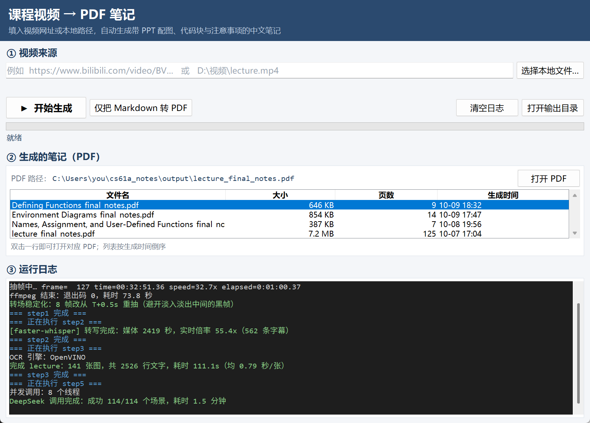
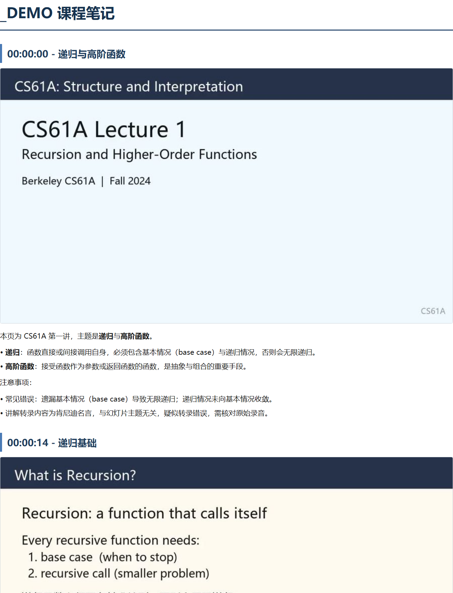

# cs61a_notes —— 课程视频自动生成笔记

给一个课程视频（本地文件或网址），自动产出带 PPT 配图、代码块和注意事项的中文笔记，
输出 **Markdown** 和 **PDF**。



**生成的笔记长这样** —— 自动挑出每页对应的 PPT、按时间轴排好，下面是模型写的中文要点：



> 上面两张图都是**自测工具生成的合成课件**（`scripts/make_test_video.py`），
> 不含任何真实课程内容。

---

## 目录

- [一、快速开始](#一快速开始)
- [二、原理：它怎么做到的](#二原理它怎么做到的)
- [三、性能](#三性能)
- [四、命令行用法](#四命令行用法)
- [五、产物一览](#五产物一览)
- [六、配置](#六配置configpy)
- [七、环境依赖（换机器时看这里）](#七环境依赖换机器时看这里)
- [八、常见问题](#八常见问题)

---

## 一、快速开始

### 安装（第一次使用）

需要 **Python 3.10+** 和 **ffmpeg**。然后在项目目录里：

```powershell
# 1) 安装 Python 依赖
pip install -r requirements.txt

# 2) 配置 API Key（不要写进代码，也不用改 config.py）
Copy-Item .env.example .env
notepad .env                     # 把 DEEPSEEK_API_KEY 换成你自己的密钥
```

密钥在 <https://platform.deepseek.com/api_keys> 申请。`.env` 已在 `.gitignore` 里，
不会被提交到 Git。

**想要转写快很多**，再装一个 GPU 环境（可选，不装会自动退回 CPU 版 whisper，能跑但慢）：

```powershell
python -m venv D:\cs61a_venv --system-site-packages
$env:TMP="D:\cs61a_pip_tmp"; $env:TEMP="D:\cs61a_pip_tmp"
D:\cs61a_venv\Scripts\python.exe -m pip install --no-deps --no-cache-dir `
  --index-url https://download.pytorch.org/whl/cu126 "torch==2.14.1+cu126"
D:\cs61a_venv\Scripts\python.exe -m pip install --no-cache-dir faster-whisper
```

然后在 `.env` 里加一行告诉程序这个环境在哪：

```
WHISPER_PYTHON=D:\cs61a_venv\Scripts\python.exe
```

> **ffmpeg 请用带 `libdav1d` 的构建**（BtbN 的 `win64-gpl` 或 gyan.dev 的 full 版）。
> 常见的 "essentials" 精简版只有 `libaom`，抽帧会慢约 4 倍。详见
> [七、环境依赖](#七环境依赖换机器时看这里)。

### 启动

**双击桌面上的 `课程笔记工具.lnk`**（推荐），或项目目录里的 `启动笔记工具.bat`。

| 启动方式 | 控制台黑框 | 移动文件夹后 | 说明 |
|---|---|---|---|
| `课程笔记工具.lnk` | **完全没有** | ❌ 会失效 | 带自定义图标，观感最好 |
| `启动笔记工具.bat` | 闪一下（约 0.2 秒） | ✅ 照常可用 | 路径是相对的；出错时会显示错误信息 |

> `.lnk` 里存的是**绝对路径**，把项目文件夹搬走后会失效，这时用 `.bat`，
> 或者在项目目录里执行一次下面的脚本重新生成（会自动用当前目录和当前 Python）：
> ```powershell
> $ws = New-Object -ComObject WScript.Shell
> $sc = $ws.CreateShortcut("$PWD\课程笔记工具.lnk")
> $sc.TargetPath = (Get-Command pythonw.exe).Source
> $sc.Arguments = '"' + "$PWD\app.py" + '"'
> $sc.WorkingDirectory = "$PWD"
> $sc.IconLocation = "$PWD\assets\notes.ico"
> $sc.Save()
> ```

### 操作步骤

1. 在输入框里填**视频路径**或**视频网址**（B 站等 yt-dlp 支持的站点都行），
   也可以点「选择本地文件…」，或者**直接把视频文件拖进窗口**
2. 点「**▶ 开始生成**」
3. 进度实时显示在「③ 运行日志」里（一节 40 分钟的课约 **6~7 分钟**）
4. 完成后「② 生成的笔记」里会列出 PDF，点「打开 PDF」或双击列表行即可

### 界面说明

| 区域 | 作用 |
|---|---|
| ① 视频来源 | 填视频网址或本地路径；支持右键粘贴、拖拽文件 |
| ▶ 开始生成 | 跑完整流程：抽帧 → 转写 → OCR → 合并场景 → 生成笔记 → 转 PDF |
| 仅把 Markdown 转 PDF | 不跑流水线，只把你手工改过的 `.md` 转成 PDF |
| ② 生成的笔记（PDF） | 显示所选 PDF 的完整路径；下方列表列出全部笔记（文件名/大小/页数/生成时间），**双击即打开** |
| ③ 运行日志 | 实时滚动每一步的输出，step 标题蓝色、成功绿色、错误红色 |

### 顺手的小功能

**复制粘贴**：从浏览器复制链接后，直接在输入框里**右键 → 粘贴**即可。

| 控件 | 右键菜单 |
|---|---|
| 视频来源输入框 | 剪切 / 复制 / 粘贴 / 全选 |
| PDF 路径框 | 复制 / 全选 / **复制路径** |
| 运行日志 | 复制 / 全选 / **复制全部日志** / 清空日志 |

键盘上的 `Ctrl+V` / `Ctrl+X` / `Ctrl+C` / `Ctrl+A` 也都支持。

**拖拽文件**：可以把视频文件从资源管理器拖进窗口，拖到哪儿都行，松手后路径自动填进输入框。
拖入后**不会自动开始**（免得手滑拖错文件就跑掉几分钟），你确认后再点「开始生成」。

> 拖拽依赖可选的第三方包 `tkinterdnd2`（tkinter 标准库不支持拖拽）：
> ```powershell
> pip install tkinterdnd2
> ```
> **没装也不影响使用**：程序自动关闭该功能并隐藏提示，其它一切照常。

---

## 二、原理：它怎么做到的

### 流水线总览

```
视频
 ├─ step1  找"画面切换"的关键帧 ──→ frames/{视频}/scene_*.jpg + output/{视频}_scene_info.json
 ├─ step2  语音转写成字幕       ──→ output/{视频}.srt
 ├─ step3  逐帧 OCR 文字        ──→ output/{视频}_ocr.json
 ├─ step4  合并场景 + 对齐字幕   ──→ output/{视频}_scenes.json
 └─ step5  逐场景生成笔记        ──→ output/{视频}_scenes.json（就地补充）
                                    output/{视频}_final_notes.md
                                    output/{视频}_final_notes.pdf
```

### 每一步用什么工具

| 步骤 | 做什么 | **用的工具** | 关键参数 |
|---|---|---|---|
| **step1** 抽帧 | 只在"画面发生切换"时存一帧，而不是每秒抽帧 | **ffmpeg**（`select='gt(scene,…)'` 滤镜 + `showinfo` 报时间戳）<br>解码走 **N 卡硬件解码 `av1_cuvid`** | `SCENE_THRESHOLD=0.05` |
| **step2** 转写 | 语音 → 带时间轴的字幕 | **faster-whisper**（CTranslate2 + CUDA） | `small` 模型、`float16`、贪心解码 |
| **step3** OCR | 抠出每张帧图上的文字，**同时记录每个文字块的 x/y 坐标** | **RapidOCR**（PP-OCRv6 模型）<br>推理引擎用 **OpenVINO** | `OCR_NUM_THREADS=8` |
| **step4** 合并 | 画面相同的相邻帧合并成一个"场景"；把字幕按时间轴切给各场景 | **imagehash**（pHash 感知哈希）+ 自写 SRT 解析 | `PHASH_THRESHOLD=8` |
| **step5** 笔记 | 逐场景让大模型写「标签 / 摘要 / 笔记」 | **DeepSeek API**（`deepseek-flash`），**8 线程并发** | `reasoning_effort="low"` |
| **出 PDF** | Markdown → PDF，图片内嵌 | **Microsoft Edge 无头模式**（`--print-to-pdf`） | 图片缩到 900px / JPEG q82 |
| **界面** | 图形界面 | **tkinter**（Python 标准库，无需安装） | — |
| **下载** | 网址 → 本地视频 | **yt-dlp** | `--no-playlist` |

### 三个关键设计

**1. 为什么先本地 OCR/转写，而不是把图片丢给大模型？**

实测这个 DeepSeek 端点是**纯文本模型**：图片会被静默替换成 `[Unsupported Image]`，
返回 HTTP 200 + 空内容，**不报错**。所以图片必须先在本地转成文字。
好处是代码、公式、缩进的识别比视觉模型更准。

**2. 为什么 step3 一定要存 x/y 坐标？**

OCR 会丢掉代码缩进（`    if n == 0:` 变成 `if n == 0:`），而 Python 缩进有语义。
缩进只能靠文字块的 **x 坐标**还原；**y 坐标**用来定行序（双栏排版时 OCR 返回顺序会乱）。
step5 靠这两个坐标还原出带缩进的代码块。

**3. 为什么抽帧要"偏移半秒"？**

`select=gt(scene,…)` 命中的时刻往往正处在**幻灯片淡入淡出的中间**——因为淡变时每帧像素
都在变，逐帧差异都超过阈值，于是整段转场被当成一串"场景切换"。实测一个 1.1 秒的转场
被抽成 10 帧，平均亮度从 240 掉到 2.6（全黑）再回升，这些黑帧会成为场景代表图。

所以每帧都改从 `T+0.5s` 重抽（幻灯片是静止的，偏移半秒对正常帧无损）：
片尾淡出往后取不到帧时自动回退到 `T-0.5s`。全片帧亮度实测从「最暗 2.6」变成「最暗 240」。

---

## 三、性能

### 实测耗时

以一节 **9 分钟**的 CS61A 录屏（1920×1080 AV1，RTX 4070）实测：

| 步骤 | 耗时 | 说明 |
|---|---|---|
| step1 抽帧 | 17.4s | 几乎全在解码整片视频上 |
| step2 转写 | 18.9s | 其中转写本身 11.4s（47 倍实时） |
| step3 OCR | 16.4s | 18 张图，0.91 秒/张 |
| step4 合并 | 1.0s | |
| step5 笔记 | 13.5s | 13 个场景 |
| 出 PDF | 4.1s | |
| **合计** | **约 71 秒** | |

**一节 40 分钟的课约 6 分钟**（同样条件下）。

### 时间花在哪

- **step1 几乎全在"解码整片视频"上**。所以优化点就是解码器本身：**ffmpeg 必须选带
  `libdav1d` 的构建**。dav1d 是最快的 AV1 软件解码器，而常见的 "essentials" 精简版
  只带 `libaom`（AV1 里最慢的）。实测同一个 13.8 分钟视频：**libaom 51.8s → dav1d 13.4s，
  快 3.9 倍，产出帧像素完全一致**。
- **step5 的时间几乎全在"等接口回话"**（单次调用本身只要 3~5 秒），所以并发接近线性提速。
- **step2 的固定开销比想象中大**：模型加载 3.3s + 音频解码 1.2s + 进程启动。
- **step3 是纯 CPU 计算**，换推理引擎（OpenVINO）比加核心数有效——实测开 8 个进程只有
  1.38 倍收益，而换引擎是 1.9 倍。

### 调参建议

| 想改什么 | 改哪里 |
|---|---|
| 转写更准（慢 4 倍） | `WHISPER_MODEL = "large-v3"`（首次会下载约 3GB 模型） |
| 抽帧更灵敏/更少 | `SCENE_THRESHOLD`（默认 0.05，**别用 0.3**，见下） |
| 合并更严格 | `PHASH_THRESHOLD`（默认 8，越小越严格） |
| 笔记更快/更省 | `DEEPSEEK_CONCURRENCY`（默认 8）、`DEEPSEEK_REASONING_EFFORT`（默认 `low`） |
| 换机器后 OCR 变慢 | 重调 `OCR_NUM_THREADS`（默认 8，建议在 4~8 之间试） |

> **`SCENE_THRESHOLD` 不要用 0.3。** 网上"电影场景检测"教程都写 0.3，但实测课件视频
> 硬切页面的 ffmpeg scene 分数只有 **0.063~0.125**，用 0.3 会**一帧都抓不到**。

> **`OCR_NUM_THREADS` 换机器必须重调。** onnxruntime 默认 (`-1`) 会开满逻辑核心，
> 在 28 核机器上严重超额订阅反而最慢：`-1`→9.57s、`4`→7.43s、**`8`→5.83s**、`16`→9.51s。

---

## 四、命令行用法

适合批量、自动化。

```powershell
cd <项目目录>

# 1) 把课程视频放进 video\（支持 mp4/mkv/flv/avi/mov/webm/ts/m4v）

# 2) 一条命令跑完（只出 Markdown）
python run.py

# 3) 想要 PDF 就再跑一步
python scripts\md_to_pdf.py --all
```

### run.py 的参数

```powershell
python run.py            # 完整跑一遍（五步串行，失败立即停止）
python run.py --from 3   # 从 step3 开始，前两步跳过
python run.py --only 5   # 只跑 step5（最常用：改完 prompt 只想重出笔记）
```

### 分步运行（调试用）

每一步都能单独跑，方便只重做某一环。

```powershell
python scripts\step1_extract_frames.py                 # 处理 video\ 下全部
python scripts\step1_extract_frames.py lecture.mp4     # 只处理指定视频

python scripts\step2_transcribe.py lecture.mp4
python scripts\step2_transcribe.py --skip-existing     # 已有 srt 就跳过

python scripts\step3_ocr.py lecture
python scripts\step4_merge_scenes.py lecture

python scripts\step5_generate_notes.py lecture
python scripts\step5_generate_notes.py --force         # 已标注的场景也重新生成
```

日志分别在 `logs\step1.log` ~ `logs\step5.log`，出错先看这里。

### 重复运行会怎样

| 步骤 | 重复运行时的行为 |
|---|---|
| step1 | 会重做（结果一致） |
| step2 | 跳过已有 srt（因为 run.py 传了 `--skip-existing`） |
| step3 | 会重做 |
| step4 | 重做，但会**沿用上次 step5 生成的笔记** |
| step5 | **跳过已有 tag 的场景**，只补没做的 → 重跑通常一次 API 都不调 |

所以：

- 「视频没变，只想重出笔记」→ `python run.py --only 5`（最快）
- 「视频没变，想连 PDF 一起重出」→ `python run.py`（step5 自动跳过，只花抽帧和 OCR 的时间）

> step4 的"沿用"很重要：step4 每次都会**完全重建** `scenes.json`，而 step5 的成果恰好写在
> 这个文件里。step4 会按**代表图文件名**把上一次的笔记沿用过来（抽帧是确定性的，同一张
> 代表图就是同一页幻灯片），日志里会打印「沿用了上次已生成的 N/M 个场景笔记」。

---

## 五、产物一览

| 文件 | 内容 |
|---|---|
| `output\{视频}_final_notes.md` | **Markdown 笔记** |
| `output\{视频}_final_notes.pdf` | **PDF 笔记**（图片内嵌，可直接分享/打印） |
| `output\{视频}_scenes.json` | 场景数据：时间轴 + OCR + 字幕 + 标签/摘要/笔记 |
| `output\{视频}_ocr.json` | 逐帧 OCR 文字（含 x/y 坐标） |
| `output\{视频}.srt` | 语音字幕 |
| `output\{视频}_scene_info.json` | 帧文件名与时间戳对应表 |
| `frames\{视频}\*.jpg` | 抽出的关键帧（笔记里的配图） |
| `logs\step1~5.log` | 各步骤运行日志 |

笔记格式（外层用四个反引号，方便里面再嵌代码块）：

````markdown
# {视频名} 课程笔记

## 00:17:36 - 函数调用环境图


本页用 Online Python Tutor 展示 `square(-2)` 的环境图与求值过程。

```python
from operator import mul
def square(x):
    return mul(x, x)
square(-2)
```

求值步骤：
- 在全局帧中绑定导入的函数 `mul` 与函数 `square`。
...
````

> Markdown 里的配图是相对路径引用的，用 VS Code 之类的编辑器打开才能看到 PPT 配图；
> PDF 里的图片是内嵌的，换任何设备都能看。

---

## 六、配置（`config.py`）

所有脚本都从这里读常量，改配置不用改代码。

| 配置项 | 默认 | 说明 |
|---|---|---|
| `FFMPEG_PATH` | `D:\ffmpeg-dav1d\...\ffmpeg.exe` | ffmpeg 绝对路径，`ffprobe` 自动推导；**要带 libdav1d** |
| `FFMPEG_HW_DECODE` | `off` | 显卡硬件解码，**默认关闭**（会随机死锁，见下） |
| `FFMPEG_STALL_TIMEOUT` | `30` | 解码停滞多少秒判定卡死并终止 |
| `DEEPSEEK_API_KEY` | 从 `.env` 读 | **不写在代码里**；也可用环境变量 `DEEPSEEK_API_KEY` 覆盖 |
| `DEEPSEEK_MODEL` | `deepseek-flash` | 也可改 `deepseek-v4-pro`（更强更贵） |
| `DEEPSEEK_CONCURRENCY` | `8` | 并发调用数，设 1 退回串行 |
| `DEEPSEEK_REASONING_EFFORT` | `low` | 思考强度，`""` 用模型默认 |
| `WHISPER_ENGINE` | `auto` | 优先 faster-whisper，不可用自动退回 openai-whisper |
| `WHISPER_MODEL` | `small` | 想更准可改 `large-v3`（更慢） |
| `WHISPER_DEVICE` | `auto` | 自动探测 CUDA；也可写死 `cuda` / `cpu` |
| `WHISPER_PYTHON` | `D:\cs61a_venv\...\python.exe` | **CUDA 版 torch 所在的 venv，别删** |
| `OCR_ENGINE` | `auto` | 优先 OpenVINO，不可用退回 onnxruntime |
| `OCR_NUM_THREADS` | `8` | **换机器要重调** |
| `OCR_MIN_CONFIDENCE` | `0.5` | 低于此置信度的 OCR 结果丢弃 |
| `SCENE_THRESHOLD` | `0.05` | 画面切换灵敏度，**别改成 0.3** |
| `SCENE_SETTLE_OFFSET` | `0.5` | 抽帧偏移秒数，避开转场淡变 |
| `PHASH_THRESHOLD` | `8` | 画面相似度合并阈值，越小越严格 |
| `STEP5_DEMOTE_NOTE_HEADINGS` | `2` | 笔记正文标题降级数，设 0 关闭 |
| `EDGE_PATH` | 空（自动找） | 生成 PDF 用的 Edge 路径 |
| `PDF_IMAGE_MAX_WIDTH` | `900` | PDF 里配图最大宽度，设 0 = 用原图 |
| `PDF_IMAGE_QUALITY` | `82` | PDF 里配图的 JPEG 质量 |

> 关于 `PDF_IMAGE_MAX_WIDTH`：这些 PPT 都是文字密集型画面，JPEG 对锐利文字边缘压缩效率
> 本来就不高，所以从 1280 缩到 900 只省了约 1/3。如果笔记要打印、想看清代码，
> 可以设成 0 用原图，代价是 PDF 变大。

---

## 七、环境依赖（换机器时看这里）

### 依赖清单

| 组件 | 位置 / 版本 | 用途 |
|---|---|---|
| ffmpeg / ffprobe | 任意带 **libdav1d** 的构建 | 抽帧、读元信息、解码音频 |
| Python 包（系统 Python 3.13） | imagehash、Pillow、rapidocr、onnxruntime、**openvino**、yt-dlp | 主流程 |
| **Microsoft Edge** | 系统自带 | Markdown → PDF 的渲染器 |
| tkinter | Python 自带 | 图形界面 |
| **CUDA 版 torch + faster-whisper** | 任意虚拟环境（`WHISPER_PYTHON` 指定） | 语音转写用 GPU |
| Whisper 模型缓存 | `WHISPER_MODEL_DIR`（默认系统缓存目录） | faster-whisper 的模型 |
| feature 可选包 | `tkinterdnd2` | 拖拽文件 |

### ffmpeg 一定要带 libdav1d

step1 的耗时几乎全在解码整片视频上，**换解码器就是直接换速度**：

| ffmpeg 构建 | 13.8 分钟 1080p AV1 抽帧扫描 |
|---|---|
| 只有 libaom（"essentials" 精简版） | 51.8s |
| **带 libdav1d（"full" / "gpl" 完整版）** | **13.4s** |

两者产出的帧**像素完全一致**，差别只在速度。

- 检查自己的 ffmpeg 有没有：`ffmpeg -buildconf | findstr dav1d`
- 下载：BtbN 的 `ffmpeg-master-latest-win64-gpl.zip` 或 gyan.dev 的 full 构建
- 换好后把 `config.py` 顶部的 `FFMPEG_PATH` 指过去即可

> `config.py` 里还留了 `FFMPEG_PATH_FALLBACK`：首选构建不存在时会自动退回旧构建，
> 并在启动检查时打印警告（不会静默变慢）。

**关于 PDF 为什么用 Edge**：这台机器上没有 pandoc / wkhtmltopdf / LibreOffice，
Edge 是唯一稳定可用且系统自带的渲染器。实测生成的 PDF 会内嵌
`MicrosoftYaHei` / `NSimSun` / `Consolas` 字体子集，中文正常显示且可搜索。

### 安装命令

```powershell
# 主流程依赖
pip install imagehash Pillow rapidocr onnxruntime openvino yt-dlp

# 可选：拖拽文件支持
pip install tkinterdnd2

# 语音转写（装在 D 盘 venv 里，避免污染系统环境）
python -m venv D:\cs61a_venv --system-site-packages
$env:TMP="D:\cs61a_pip_tmp"; $env:TEMP="D:\cs61a_pip_tmp"
D:\cs61a_venv\Scripts\python.exe -m pip install --no-deps --no-cache-dir `
  --index-url https://download.pytorch.org/whl/cu126 "torch==2.14.1+cu126"
D:\cs61a_venv\Scripts\python.exe -m pip install --no-cache-dir faster-whisper
```

### 关于 `D:\cs61a_venv`

这里是一个 `--system-site-packages` 虚拟环境，它继承系统 Python 里已装的 numpy 等包，
只是把 torch 换成 CUDA 版（`2.14.1+cu126`），不污染系统环境。

**如果这个 venv 被删了会怎样**：step2 会自动退回系统自带的 CPU 版 whisper，**能跑，但慢
约 17 倍**——一节 40 分钟的课从 0.9 分钟变成 1 小时以上。

### 模型下载（国内网络注意）

faster-whisper 从 HuggingFace 拉模型，而 **huggingface.co 国内直连不通**，
所以 `config.py` 里已设好国内镜像，代码里也关掉了镜像站不代理的 Xet 加速通道：

```python
WHISPER_HF_ENDPOINT = "https://hf-mirror.com"   # 镜像
WHISPER_MODEL_DIR   = r"D:\cs61a_models"        # 模型缓存目录
```

---

## 八、常见问题

| 现象 | 原因与处理 |
|---|---|
| **生成 PDF 时报 `platform_channel ... 拒绝访问`** | 程序跑在受限环境里（典型是 DSH 沙箱的终端）。Edge 是多进程架构、靠命名管道通信，沙箱禁止命名管道。**在沙箱外的普通终端运行，或直接双击快捷方式**就正常 |
| **笔记里的 PPT 配图发黑** | 抽帧落在了幻灯片淡入淡出过程中，已由 `SCENE_SETTLE_OFFSET` 处理。若仍有，重跑 step1 |
| **`Library cublas64_12.dll is not found`** | CTranslate2 找不到 CUDA 库。`step2_transcribe.py` 会自动从 `torch\lib` 加载，若仍报错请确认 `D:\cs61a_venv` 完整 |
| **下载模型报 `WinError 10054`** | huggingface.co 直连不通，确认 `WHISPER_HF_ENDPOINT` 设为镜像 |
| **笔记里的图片打不开** | 图片路径是相对 `output/` 的 `../frames/...`。把 md 挪到别处时需保持 `frames/` 的相对位置 |
| **拖拽文件没反应** | 先确认装了 `tkinterdnd2`（没装时不会显示拖拽提示）。另外 Windows 禁止低权限程序接收来自管理员程序的拖放——别用管理员身份启动 |
| **`step1 报 Option not found`** | ffmpeg 版本的 `-vsync`/`-fps_mode` 写法不匹配。脚本已自动探测两种写法；仍报错请检查 `FFMPEG_PATH` |
| **下载 YouTube 时提示 `No supported JavaScript runtime`** | 只是 WARNING，不影响下载。常规画质不受影响 |

---

## 九、开发者备注

### 目录结构

```
cs61a_notes/
├─ app.py                    图形界面（tkinter）
├─ run.py                    命令行串行执行 step1~5
├─ config.py                 所有常量都在这里
├─ .env                      你的 API Key（不进 Git）
├─ .env.example              密钥配置模板
├─ requirements.txt          Python 依赖清单
├─ scripts/
│  ├─ step1_extract_frames.py    抽帧
│  ├─ step2_transcribe.py        语音转写
│  ├─ step3_ocr.py               逐帧 OCR
│  ├─ step4_merge_scenes.py      合并场景 + 对齐字幕
│  ├─ step5_generate_notes.py    调 DeepSeek 生成笔记
│  ├─ md_to_pdf.py               Markdown → PDF
│  └─ make_icon.py               生成图标
├─ assets/                   图标
├─ video/ frames/ output/ logs/
```

### 改代码时留意

- **子进程必须带 `CREATE_NO_WINDOW`**：`pythonw` 没有控制台，而 Windows 上 `subprocess`
  默认会给"控制台程序"新建一个控制台窗口。step1 要调很多次 ffmpeg（探测 + 抽帧 +
  逐帧重抽），不加就会一个接一个地闪黑框。
- **不要打开显卡硬件解码**（`FFMPEG_HW_DECODE`，默认 `off`）：`av1_cuvid` 会**随机死锁**——
  实测同一条命令、同一个视频，一次 24 秒正常跑完，下一次就卡在 85% 处再不前进。
  它也不比 `libdav1d` 快（24s vs 13.4s）。`run_ffmpeg()` 里的停滞看门狗是兜底，不是许可证。
  另外别把 `-hwaccel cuda` 和 `-c:v av1_cuvid` 当成一回事：前者要每帧从显存拷回内存过
  滤镜，实测比软件解码还慢 4 倍。
- **`step1`/`step2` 筛选视频时用 `config.VIDEO_EXTENSIONS`，不要写死 `.mp4`**，
  否则从 YouTube 下到的 `.webm` 会被漏掉。
- **解析拖放数据不要用 `root.tk.splitlist()`**：它按 Tcl 列表规则解析，会在**没有花括号
  包裹**的元素里处理反斜杠转义，而 Windows 路径全是反斜杠，路径会被静默碾碎
  （`C:\a\1.mp4` → `C:\x07\x01.mp4`）。`app.py` 里的 `parse_drop_list()` 自己解析。
- **并发写 `scenes.json` 必须加锁**，否则多个线程同时写会把文件写坏。
- **`scripts\extract_frames.py`** 是早期版本（带 pHash 去重 + 兜底定时抽帧），与 step1 功能
  重叠，**当前流水线不使用它**，保留仅供参考。
- **`scripts\make_test_video.py`** 是自测工具，能造一个带真实语音的合成课件视频。
  注意 `run.py` 会处理 `video/` 下的**所有**视频，正式使用前记得删掉测试视频。
